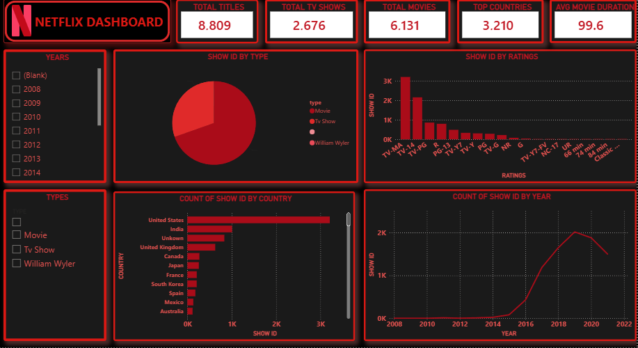

🎬 Netflix Content Analysis — Final Data Analytics Project

📌 Problem Statement
Netflix needs to understand its content catalog to support content strategy decisions. This project analyzes the Netflix Movies and TV Shows dataset to identify patterns in content type, geographic distribution, audience ratings, and content growth over time — providing data-driven insights for business stakeholders.

📁 Dataset Information
- **Source:** Netflix Movies and TV Shows dataset (Kaggle, by Shivam Bansal)
- **Original file:** netflix_titles.csv
- **Original rows:** 8,807
- **Columns:** 12 (show_id, type, title, director, cast, country, date_added, release_year, rating, duration, listed_in, description)

🧹 Data Cleaning Process
Performed using Microsoft Excel (Power Query):
1. Filled missing values in director, cast, and country with "Unknown" to preserve the rest of each row's data
2. Removed rows with blank date_added or rating (minimal rows affected)
3. Converted date_added to a proper date format; added year_added and month_added columns
4. Split duration into duration_int (number) and duration_type (min / Season)
5. Split country into primary_country, keeping only the first listed country
6. Standardized the type column capitalization (Movie, TV Show)
7. Removed duplicate rows based on show_id
8. Trimmed extra spaces from all text columns

**Result:** Clean dataset of 8,809 rows ready for analysis.

🔍 Analysis (Exploratory Data Analysis)
Performed using SQL (MySQL Workbench) on the cleaned dataset.

**Key queries covered:**
- Content type distribution
- Year-wise content addition trends
- Top 10 content-producing countries
- Rating distribution
- Average movie duration

**Findings:**
- Movies: 6,131 titles (69.6%) | TV Shows: 2,676 titles (30.4%)
- Top countries: United States (3,210), India (1,008), United Kingdom (628)
- Most common rating: TV-MA (3,207), followed by TV-14 (2,160)
- Average movie duration: 99.6 minutes
- Content additions grew sharply between 2016-2020, peaking around 2019

📊 Dashboard
Built using Power BI Desktop to visually communicate the findings.

**Includes:**
- 5 KPI cards (Total Titles, Movies, TV Shows, Top Country Count, Avg Movie Duration)
- Pie chart — Content type distribution
- Bar chart — Top 10 countries
- Bar chart — Rating distribution
- Line chart — Content growth over years
- Interactive filters (Type, Year Added)

💡 Key Business Insights
1. **Movies dominate the catalog** (69.6%) — Netflix's library leans heavily toward films over series.
2. **Geographic concentration** — The US, India, and UK together account for a significant share of content, suggesting these are Netflix's priority content markets.
3. **Mature-audience skew** — TV-MA being the top rating indicates the catalog is weighted toward adult content, which could inform content acquisition strategy for broader audience reach.
4. **Standard movie runtime** — At ~99.6 minutes average, Netflix movies align with typical theatrical lengths.
5. **Aggressive expansion phase (2016-2020)** — The sharp growth trend reflects Netflix's content investment strategy during its global expansion years, with growth leveling off after 2020.

🛠️ Tools Used
- Microsoft Excel (Power Query) — Data Cleaning
- MySQL Workbench (SQL) — Exploratory Data Analysis
- Power BI Desktop — Dashboard & Visualization

📂 Project Files
- netflix_titles.csv — original raw dataset
- Netflix_Cleaned.csv / .xlsx — cleaned dataset
- netflix_eda_queries.sql — SQL queries used for analysis
- Netflix_Dashboard.pbix — Power BI dashboard
- NETFLIX DASHBOARD.png — dashboard preview image

📝 Note
A small number of rows (13 out of 8,809) had a missing date_added value, resulting in a year_added of 0 for those rows. This represents less than 0.2% of the dataset and does not materially affect the overall findings.

🔗 Related Repositories
- Task 1 (Data Cleaning): SWYNEX-Data-Cleaning-Preparation
- Task 2 (EDA): SWYNEX-EDA-Analysis
- Task 3 (Dashboard): SWYNEX-Interactive-Dashboard
